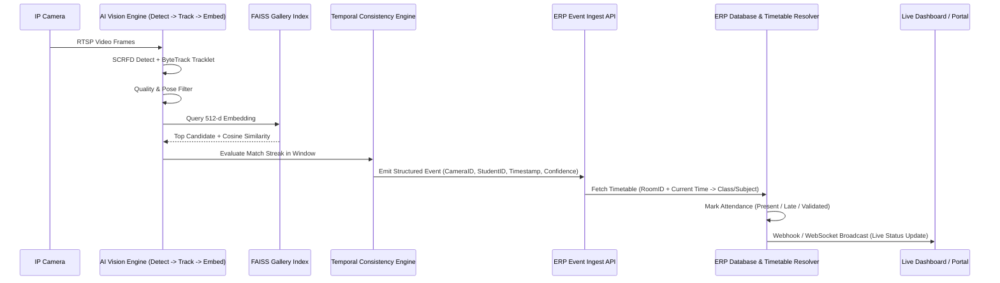

# Unified AI Vision Platform & School ERP System Blueprint

## 1. System Vision & Paradigm
The system is built as an end-to-end, integrated enterprise solution consisting of four tightly coupled pillars:
```
[ RTSP / IP Cameras ] 
        │
        ▼
[ AI Vision Platform (Edge/On-Prem) ]
        │  (Structured Attendance & Campus Events)
        ▼
[ Custom School ERP Core ] ───► [ Real-Time Dashboards & Portals ]
```
The **Custom School ERP** is a **first-class core system**, not merely an external integration target. It owns the school's operational truth (timetables, room mappings, enrollments, leave applications, class rosters) and actively resolves real-time AI perception streams into verified academic attendance and safety events.

---

## 2. Architecture Pillars

### Pillar 1: Camera Infrastructure & Stream Ingestion
- **Protocols & Ingestion**: RTSP, ONVIF, WebRTC, MJPEG stream consumers with hardware-accelerated decoding (NVDEC/VAAPI/QuickSync).
- **Topology**: Edge appliances / on-premise compute nodes deployed per campus/wing, streaming frame-level detections or downsampled crops to local inference engines.
- **Failover & Buffering**: Local ring-buffers for intermittent network disruptions with timestamped event replay.

### Pillar 2: AI Vision & Biometrics Platform
- **Object / Person Detection**: 
  - YOLO (v8/v9/v10/v11), RT-DETR, RF-DETR, Grounding DINO for generalized open-vocabulary context or perimeter monitoring.
- **Face Detection & Alignment**: 
  - SCRFD (ultra-fast, multi-scale), RetinaFace (robust landmarking under pose variance).
- **Face Quality & Preprocessing Pipeline**:
  - Head pose estimation (yaw, pitch, roll thresholds).
  - Blur detection (Laplacian variance), illumination/exposure validation, occlusion scoring.
  - Multi-angle enrollment pipeline for generating high-quality reference galleries.
- **Biometric Embeddings & Feature Extraction**:
  - ArcFace, AdaFace (adaptive margin for low-quality surveillance images), SFace, DeepFace, InsightFace models.
- **Multi-Object Tracking & Re-Identification (ReID)**:
  - ByteTrack for tracklet continuity across camera frames, combined with deep ReID appearance vectors to prevent identity swapping during occlusions.
- **Vector Search & Gallery Matching**:
  - FAISS (IndexFlatIP / IndexIVFFlat / HNSW) for sub-millisecond similarity search across thousands of student/staff identity vectors.
- **Attendance Decision & Temporal Consistency Engine**:
  - Sliding temporal windows ($T$ seconds) requiring $N$ consistent positive match frames.
  - Probabilistic confidence thresholds, unknown/ambiguous entity routing, and camera-to-room spatial validation.

### Pillar 3: First-Class Custom School ERP
- **Core Entities**:
  - `Institutions`, `Campuses`, `Wings`, `Rooms/Classrooms`, `CameraNodes`.
  - `Students`, `Guardians`, `Teachers`, `Staff`, `Classes`, `Sections`.
  - `TimetablePeriods` (linking Class + Section + Room + Teacher + Subject + TimeSlot).
  - `BiometricProfiles` (FAISS vector IDs, feature embeddings, quality scores, enrollment audit metadata).
  - `AttendanceLogs` (raw detection events vs. timetable-reconciled attendance records).
  - `CampusIncidents` / `SafetyAlerts` (unauthorized access, loitering, perimeter violations).
- **ERP Modules**:
  - **Academic Engine**: Class scheduling, master timetable, substitutions.
  - **Attendance Engine**: Automated status resolution (`PRESENT`, `LATE`, `LEFT_EARLY`, `ABSENT`, `FLAGGED_AMBIGUOUS`), manual teacher override workflows.
  - **Student & Staff Lifecycle**: Onboarding, profile management, enrollment photo intake.
  - **Security & Alerts Hub**: Real-time push notifications for unknown persons or unauthorized zone entries.
  - **Compliance, RBAC & Audit Trails**: Strict permission tiers (`SuperAdmin`, `Principal`, `Teacher`, `SecurityGuard`, `Parent`). Biometric data privacy regulations and tamper-evident audit logs.

### Pillar 4: Real-Time Dashboards & Portals
- **Admin Control Center**: Camera health, system FPS/latency monitors, campus-wide occupancy heatmaps, audit logs, model benchmark dashboard.
- **Teacher Classroom Console**: Live class attendance roster, one-tap overrides, manual verification for ambiguous detections.
- **Parent/Student Portal**: Daily attendance logs, notification feed, timetable overview.
- **Security Guard Station**: Live alerts for unassigned persons, blacklist matches, and restricted zone entry.

---

## 3. AI → ERP Event Flow


---

## 4. Production Engineering & Benchmarking Metrics
- **Computer Vision Metrics**: True Positive Rate (TPR), False Acceptance Rate (FAR), False Rejection Rate (FRR), Rank-1 Identification Accuracy, Track Fragmentation Rate.
- **System Metrics**: Per-stream Processing FPS, End-to-End Latency (camera frame capture to ERP attendance entry $\le 1.5\text{s}$), GPU VRAM utilization, Vector Search Latency ($< 5\text{ms}$).
- **Data Privacy**: Biometric vectors stored with encryption at rest; raw facial crops purged or anonymized according to campus retention policies.

---

## 5. Development Roadmap Priorities
1. **Repository Layout & Monorepo Strategy**: Clean separation into `apps/vision-engine`, `apps/erp-backend`, `apps/dashboard`, and `packages/shared-types`.
2. **ERP Core Data Schema & Timetable Engine**: Setup database models and timetable resolution logic.
3. **AI Pipeline & Detection/Tracking Service**: Modular pipeline swapping (YOLO/SCRFD/ArcFace/ByteTrack/FAISS).
4. **Event Ingestion Bridge & Temporal Engine**: Connecting AI detections reliably to the ERP event bus with deduplication and temporal aggregation.
5. **Portals & Real-Time Monitoring**: Interactive UI for operations, live attendance, and system health.
